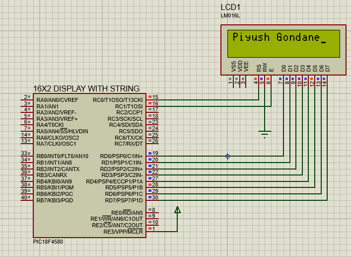

# 16x2 LCD Interfacing with PIC18F4580

## 📌 About the Project
This project demonstrates interfacing a 16x2 character LCD with the PIC18F4580 microcontroller using Embedded C.

The objective is to understand LCD initialization, command and data operations, and displaying text through microcontroller GPIO pins.

## 🛠️ Hardware and Software
- **Microcontroller:** PIC18F4580
- **Display:** 16x2 Character LCD
- **Programming Language:** Embedded C
- **IDE:** MPLAB
- **Simulation:** Proteus Design Suite

## ⚙️ Concepts Covered
- LCD initialization
- Command and data registers
- RS and Enable control signals
- Sending commands and characters
- Displaying text on the LCD
- GPIO configuration

## 🔌 Circuit Diagram

## 💻 Source Code
The Embedded C source code for the LCD interfacing program is available in this repository.

## 📚 Learning Outcomes
- Understood the basics of 16x2 LCD interfacing.
- Practiced configuring microcontroller pins.
- Learned how commands and character data are sent to an LCD.
- Gained practical experience with embedded programming and circuit simulation.

## 👨‍💻 Author
Piyush Gondane
